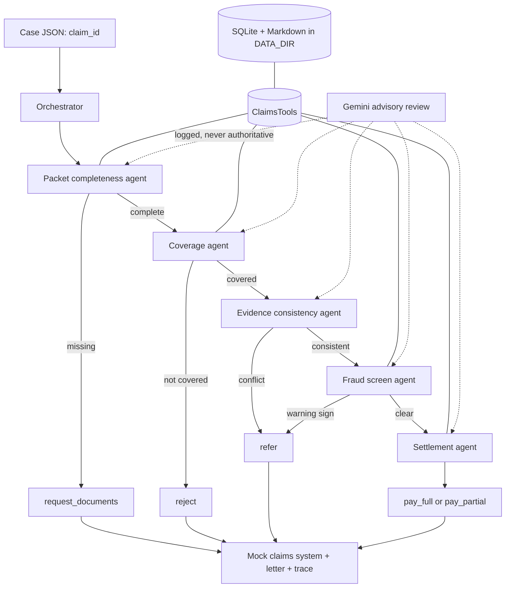

# UC6 architecture

The solid path is the decision path. The dashed model-review path can fail without changing the deterministic, policy-grounded result. Each specialist result is validated and retried once before the orchestrator acts on it.
